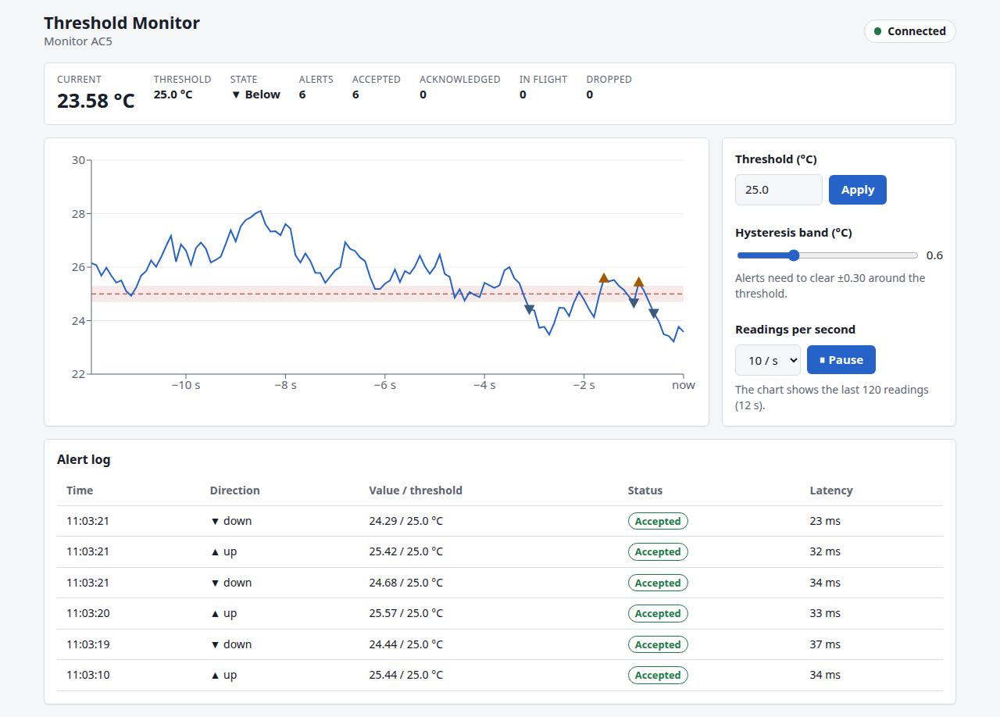
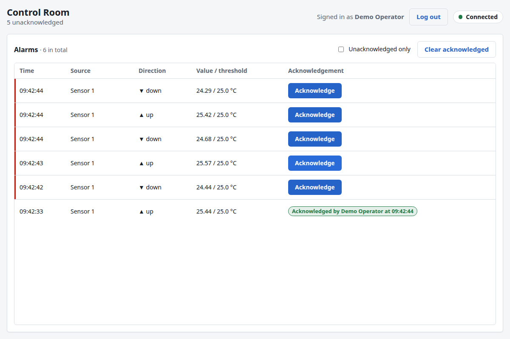

# Threshold Monitor

[](https://github.com/krisshkodrani/threshold-monitor/actions/workflows/ci.yml)

A sensor agent reads a value, finds the crossings of a threshold and sends an
alert for each crossing. A relay server stores each alert and sends it to the
monitors and the control rooms. The monitor shows the live readings and the
alerts, and its users change the shared threshold. In a control room, an
operator acknowledges the alarm, and the monitor shows who acknowledged it.
Users log in, and the relay keeps users, sessions, alerts and settings in
SQLite.

| Monitor                                                               | Control room                                                            |
| --------------------------------------------------------------------- | ----------------------------------------------------------------------- |
|  |  |

## Quick start

You need Node 24 and pnpm 11. Corepack installs the correct pnpm version from
`package.json`.

```sh
corepack enable
pnpm install
pnpm dev
```

`pnpm dev` starts four processes:

| Process      | URL                            | Note                                                           |
| ------------ | ------------------------------ | -------------------------------------------------------------- |
| Monitor      | http://localhost:5173/         | Vite dev server; it sends `/ws` to the relay                   |
| Control room | http://localhost:5174/control/ | Vite dev server; it sends `/ws` to the relay                   |
| Relay        | http://localhost:8080/         | Development mode: it accepts the two Vite origins              |
| Sensor       | (no URL)                       | 10 readings each second to the relay, with a development token |

The relay and the sensor use the same development `SENSOR_TOKEN`, from
`server/.env.development` and `sensor/.env.development`.

In development, the relay adds three demo users (`DEMO_USERS=true` in
`server/.env.development`). The password of each is `demo`.

| Username   | Role       | Can open         |
| ---------- | ---------- | ---------------- |
| `operator` | `operator` | The control room |
| `monitor`  | `monitor`  | The monitor      |
| `demo`     | both       | Both apps        |

The database is in `data/threshold-monitor.db`. To start again with no data,
stop `pnpm dev` and delete the `data` folder.

## Production build

```sh
pnpm build
export SENSOR_TOKEN=$(openssl rand -hex 24)
pnpm start                       # the relay
node sensor/dist/index.js        # the sensor, in a second terminal with the same token
```

The relay serves everything on one port, with no CORS:

| Path           | Content                                                      |
| -------------- | ------------------------------------------------------------ |
| `/`            | The monitor                                                  |
| `/control/`    | The control room                                             |
| `/login`       | The login page (one for both apps)                           |
| `/api/login`   | `POST`: check the password, set the cookie                   |
| `/api/logout`  | `POST`: end the session, close its sockets                   |
| `/api/session` | `GET`: the signed-in user, or `401`                          |
| `/ws`          | The WebSocket relay (a session or a token)                   |
| `/healthz`     | Liveness: `{"status":"ok"}`                                  |
| `/readyz`      | Readiness: `503` while the database fails or the relay stops |

## Users

Production has no users at first. Add each user with the CLI. The password
comes from stdin, so it is not in the shell history:

```sh
pnpm build
echo 'a-long-password' | pnpm --filter @app/server user:add kris --name "Kris" --roles operator,monitor
```

Usernames use `a-z`, `0-9`, `.`, `_` and `-`. The display name (1 to 40
characters) is the name in "Acknowledged by". Passwords need at least 8
characters. The roles are `operator` (control room) and `monitor`.

The relay settings are environment variables. All are optional, but without
`SENSOR_TOKEN` no sensor can connect. Refer to [.env.example](.env.example).

| Variable            | Default                     | Purpose                                                                                    |
| ------------------- | --------------------------- | ------------------------------------------------------------------------------------------ |
| `PORT`              | `8080`                      | HTTP and WebSocket port                                                                    |
| `NODE_ENV`          | `production`                | `production` accepts WebSockets from the same origin only                                  |
| `ALLOWED_ORIGINS`   | (empty)                     | A comma-separated list of origins; it replaces the default origin rule                     |
| `STATIC_DIR`        | `apps/`                     | The folder that contains `monitor/dist` and `control/dist`                                 |
| `LOG_LEVEL`         | `info`                      | `debug`, `info`, `warn` or `error`; the relay writes JSON lines                            |
| `DATABASE_PATH`     | `data/threshold-monitor.db` | The SQLite file for users, sessions and alerts                                             |
| `SESSION_TTL_HOURS` | `12`                        | How long a login lasts                                                                     |
| `COOKIE_SECURE`     | `false`                     | Set `true` when the app runs behind HTTPS                                                  |
| `TRUST_PROXY`       | `false`                     | Set `true` behind one reverse proxy: the login limit uses `X-Forwarded-For`                |
| `DEMO_USERS`        | `false`                     | `true` adds the demo users `operator`, `monitor` and `demo`; not for production            |
| `SENSOR_TOKEN`      | (empty)                     | The sensor's token, 16 characters or more; the same value as in the sensor                 |
| `SENSOR_TOKEN_FILE` | (empty)                     | Without `SENSOR_TOKEN`: read the token from this file, or make it there on the first start |

The sensor reads its own environment variables. Only the token is
necessary: `SENSOR_TOKEN`, or `SENSOR_TOKEN_FILE` (the sensor only reads the
file; the relay makes it).

| Variable            | Default                  | Purpose                                                  |
| ------------------- | ------------------------ | -------------------------------------------------------- |
| `SENSOR_TOKEN`      | (none)                   | The relay's `SENSOR_TOKEN`; the sensor stops without it  |
| `SENSOR_TOKEN_FILE` | (none)                   | Without `SENSOR_TOKEN`: the file with the token          |
| `RELAY_URL`         | `ws://localhost:8080/ws` | The relay's WebSocket URL                                |
| `SENSOR_ID`         | a fixed UUID             | Alerts and settings stay with the sensor after a restart |
| `SENSOR_LABEL`      | `Sensor 1`               | The name in the monitor and in the alerts                |
| `SENSOR_RATE_HZ`    | `2`                      | 1, 2, 5 or 10 readings each second                       |
| `SENSOR_SEED`       | `20261014`               | The seed of the random data                              |
| `LOG_LEVEL`         | `info`                   | `debug`, `info`, `warn` or `error`; JSON lines           |

## Docker

```sh
docker compose up --build                     # no setup
DEMO_USERS=true docker compose up --build     # with the demo users
```

The image (`node:24-alpine`, approximately 250 MB) contains the server bundle,
its three production dependencies, the sensor bundle and both built apps.
Compose starts two containers from it: `relay` and `sensor`. The sensor starts
after the relay is healthy. On its first start, the relay makes a random
sensor token in the data volume (`/app/data/sensor-token`, mode `0600`), and
later starts use the same token. The sensor mounts the volume read-only and
reads the token there. To use your own token, put `SENSOR_TOKEN` in a `.env`
file; it has priority over the file. Both containers run as the `node` user. A health
check calls `/healthz` every 15 seconds. On `docker compose stop`, the relay
closes each client connection with code 1001, and the clients reconnect when
it starts again.

The database is in the volume `data` (`/app/data`). The rest of the container
filesystem is read-only. Add a user:

```sh
echo 'a-long-password' | docker compose exec -T relay \
  node dist/cli.js user:add kris --name "Kris" --roles operator,monitor
```

The demo users are off unless you start with `DEMO_USERS=true`. Do not use
them in production.

## Architecture

Refer to [docs/architecture.md](docs/architecture.md) for the design and its
limits, [docs/adr](docs/adr) for the main decisions, and
[docs/roadmap.md](docs/roadmap.md) for the milestones.

```
 sensor/  ──reading, alert──▶  server (relay)  ──alert──────▶  apps/control
 (Node)   ◀──accepted───────   /ws, SQLite     ◀──ack────────  (browser)
          ◀──settings───────                   ──reading,────▶ apps/monitor
                                               ──alert───────▶ (browser)
                                               ◀─setSettings──
          ◀────────────── acknowledged, sensorStatus ─────────▶
                         packages/protocol
              (shared zod schemas for every message)
```

| Part                | What it does                                                                                                 |
| ------------------- | ------------------------------------------------------------------------------------------------------------ |
| `packages/protocol` | The message schemas (zod), their types, and parse functions that do not throw                                |
| `packages/ui`       | `DataTable<T>` (column definitions, scroll box, sticky header) and `ErrorBoundary` (both apps)               |
| `packages/client`   | The relay connection, `useRelay`, the session check, `ConnectionBadge` and `AccountBar` (both apps)          |
| `sensor`            | Node service: random-walk data, crossing detector with hysteresis, outbox, WebSocket transport               |
| `apps/monitor`      | Live chart, alert log, shared threshold and hysteresis, sensor status                                        |
| `server`            | Native `ws` relay: login, sessions, SQLite, validation, dedupe, routing, rate limit, heartbeat, static files |
| `apps/control`      | Alarm list, acknowledgements                                                                                 |

The relay does no domain logic. It checks the session or the sensor token,
checks each message against the schema and the sender's role, stores alerts
and settings, and sends each message to the correct clients. A client with
more than 1 MiB in its send buffer skips readings until it catches up; it
still gets each alert.

ESLint keeps the import direction: domain code uses no React, UI or I/O;
components never use the relay connection; the relay rules (`routing.ts`)
use no sockets; the shared packages do not know the apps. Each part of the
UI (chart, readout, tables) has an error boundary, so an error in one part
does not remove the page.

The app pages have a strict CSP (scripts, styles and the WebSocket only from
the same origin), `nosniff` and `frame-ancestors 'none'`. Hashed assets are
cached for a year; `index.html` is checked on each visit.

### Messages

The browser sends the session cookie with the WebSocket upgrade. Each client
sends `hello` first, with its role (`monitor`, `control` or `sensor`). For a
browser, the role must be one of the user's roles. The sensor has no session:
its `hello` contains `SENSOR_TOKEN`. The relay answers with `welcome`, which
contains up to 100 recent alerts, the settings, the sensor and, for a
monitor, the last 120 readings. The protocol version is 3 (ADR 0009).

| From         | Message           | To                                  |
| ------------ | ----------------- | ----------------------------------- |
| Sensor       | `reading`         | Relay, then all monitors            |
| Sensor       | `alert`           | Relay                               |
| Relay        | `accepted`        | The sensor                          |
| Relay        | `alert`           | All monitors and control rooms      |
| Sensor       | `settingsApplied` | Relay (only if no settings stored)  |
| Monitor      | `setSettings`     | Relay                               |
| Relay        | `settings`        | The sensor and all monitors         |
| Relay        | `sensorStatus`    | All browsers, when the sensor comes |
| Control room | `ack`             | Relay                               |
| Relay        | `acknowledged`    | All clients                         |
| Relay        | `error`           | The client that caused it           |

Close codes: 4001 (no valid `hello`), 4002 (unsupported protocol version; the
clients do not reconnect), 4003 (no session, wrong role, wrong sensor token or
logout; the apps go to the login page), 4005 (a sensor with a different id is
already connected),
4008 (rate limit), 1001 (relay shutdown).

### Detection

The sensor uses a Schmitt trigger. The band is threshold ± hysteresis / 2.
An alert occurs only when a reading leaves the band on the other side. The
first reading never causes an alert, and a change of the settings never causes
an alert.

### Delivery

Alerts are delivered at least once, and the relay removes duplicates by
alert id. Readings are delivered at most once: the sensor sends them only
while it is connected.

1. The sensor puts each alert in an outbox (maximum 50; the oldest is dropped
   and logged).
2. After `welcome`, the sensor sends the outbox in order. Each alert waits for
   `accepted` for 5 seconds.
3. After a timeout or a disconnect, the alert goes back into the queue and the
   sensor sends it again with the same id.
4. The relay answers a repeated alert with `accepted` and `duplicate: true`. It
   does not send it to the monitors and control rooms again.
5. After a reconnect, the sensor compares `welcome.recent` with its outbox, so
   it does not send alerts that the relay already has.

Reconnect delay: `min(30 s, 500 ms × 2^n) × (0.5 + random × 0.5)`.

## Project layout

```
apps/
  monitor/       React 19, Redux Toolkit, Recharts, Vite
  control/       React 19, useReducer, Vite (served under /control/)
server/          Node 24, ws, sirv, node:sqlite, bundled with tsup
sensor/          Node 24, the sensor agent, bundled with tsup into one file
packages/
  protocol/      zod schemas, shared by all four
  ui/            DataTable and ErrorBoundary, shared by the two apps
  client/        relay connection and session check, shared by the two apps
e2e/             Playwright test against the production build
docs/
  architecture.md  parts, state, message flow, scaling limits
  adr/             architecture decision records 0001 to 0010
  roadmap.md       milestones, decisions, next steps
Dockerfile, docker-compose.yml
```

## Tests

```sh
pnpm test          # unit and integration tests, all packages
pnpm test:e2e      # production build, then Playwright in Chromium
pnpm typecheck
pnpm lint
pnpm format:check
```

Before the first `pnpm test:e2e`, install the browser once:
`pnpm --filter @app/e2e exec playwright install chromium`.

CI runs all of these commands, `pnpm audit` and `pnpm build` on each push.
Dependabot opens weekly update PRs for npm, GitHub Actions and Docker. A second CI job
builds the Docker image, starts `docker-compose.yml`, and waits until the
relay is healthy and the sensor is connected.

### Core Web Vitals

`e2e/web-vitals.spec.ts` measures LCP, CLS and INP on the production build,
with the CPU 4 times slower (like the Lighthouse mobile preset). It uses the
browser's `PerformanceObserver` entries and fails above the "good" limits of
web.dev. These are lab values on a local network, not field data.

| Page                                 | LCP    | CLS   | INP     |
| ------------------------------------ | ------ | ----- | ------- |
| Login                                | 120 ms | 0     | < 16 ms |
| Monitor (5 s of live data, a change) | 180 ms | 0.016 | 24 ms   |
| Control room (an acknowledgement)    | 125 ms | 0.006 | 24 ms   |
| Limit ("good")                       | 2.5 s  | 0.1   | 200 ms  |

| Package             | Tests | What they cover                                                                                                                                                                                                                                                                                  |
| ------------------- | ----- | ------------------------------------------------------------------------------------------------------------------------------------------------------------------------------------------------------------------------------------------------------------------------------------------------ |
| `server`            | 165   | Routing rules (also the alert source check), relay on real sockets, sensor token and token file, slow clients, sessions and roles, login routes and rate limit (also behind a proxy), passwords, alert and settings stores, configuration, HTTP headers and methods, readiness, fatal error logs |
| `apps/monitor`      | 97    | Store slices, components, shared settings form, lazy chart, error boundary, accessibility (axe)                                                                                                                                                                                                  |
| `sensor`            | 100   | Detector (with fast-check properties), random walk, outbox, backoff, transport contract on a fake relay, the agent, one test against the real relay, token configuration, fatal error logs                                                                                                       |
| `packages/protocol` | 54    | Each message schema, valid and invalid                                                                                                                                                                                                                                                           |
| `apps/control`      | 20    | Alarm list rules, Acknowledge flow, error boundary, accessibility (axe)                                                                                                                                                                                                                          |
| `packages/ui`       | 8     | DataTable (rows, columns, widths, row keys, scroll region, empty state, axe) and ErrorBoundary                                                                                                                                                                                                   |
| `packages/client`   | 15    | Relay connection for both roles (hello, welcome, backoff, 4002 and 4003), connection badge                                                                                                                                                                                                       |
| `e2e`               | 10    | The production build with the sensor: the full alarm flow, two monitor tabs, a wrong role, a wrong password, the CSP with no violation, headers, readiness, Core Web Vitals                                                                                                                      |

## Decisions and changes from the specification

The ADRs record the main decisions:

- [0001](docs/adr/0001-native-websocket-relay.md): a native WebSocket relay, no Socket.IO
- [0002](docs/adr/0002-shared-protocol-package.md): one shared protocol package with runtime validation
- [0003](docs/adr/0003-crossing-detection-with-hysteresis.md): edge-triggered crossing detection with hysteresis
- [0004](docs/adr/0004-at-least-once-delivery.md): at-least-once delivery with server-side dedupe
- [0005](docs/adr/0005-relay-security-defaults.md): relay security defaults
- [0006](docs/adr/0006-login-with-sessions.md): login with server sessions
- [0007](docs/adr/0007-sqlite-storage.md): SQLite for users, sessions and alerts
- [0008](docs/adr/0008-shared-ui-package.md): a shared UI package for the data table
- [0009](docs/adr/0009-sensor-agent.md): a sensor agent makes the data, the monitor shows it
- [0010](docs/adr/0010-shared-client-package.md): a shared client package for the two apps

The main changes from the specification are:

- Node 24 (the current LTS) in place of Node 22.
- A rate limit of 60 messages (refill 10 each second) in place of 20 for the
  browsers. The sensor has its own limit of 600 (refill 50 each second): it
  sends 10 readings each second and can send its full outbox of 50 alerts at
  once after a reconnect.
- The data source, the detector and the outbox are in a sensor service, not
  in the monitor app (ADR 0009). All monitor tabs show the same data.
- The apps share the protocol, the generic UI parts (`@app/ui`, ADR 0008) and
  the relay connection with the session check (`@app/client`, ADR 0010). The
  sensor has its own transport and its own copy of the backoff function.

## Limits and next steps

- One relay process with a local SQLite file; there is no horizontal scaling.
- Users are added with the CLI only. There is no admin page and no password
  change. Single sign-on (OIDC) can use the same session cookie later.
- The outbox is in memory only. On SIGTERM, the sensor waits up to 3 s for
  the relay to accept the queued alerts. If the relay is offline for all of
  that time, the alerts are lost and the sensor logs their count.
- One sensor at a time. A gap in the sensor's connection is a gap in the
  chart, because readings are not stored.
- The `alerts` table grows without a limit; a retention job is a next step.
- The app has no TLS. Use a reverse proxy for HTTPS, and set `COOKIE_SECURE`
  and `TRUST_PROXY`. Without `TRUST_PROXY`, all users behind the proxy share
  one login limit.
- No error tracking (for example, Sentry), metrics or tracing. The relay and
  the sensor write JSON logs, and the error boundaries log to the console.

Refer to the scaling section in [docs/architecture.md](docs/architecture.md)
for the changes that each limit needs.
